# CONTRACT ZERO: Player's Field Manual

**The world remembers what you take.**

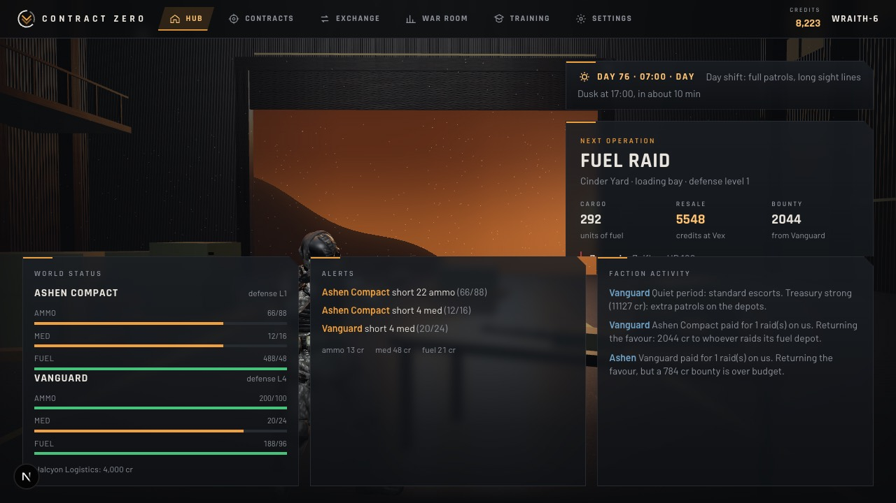

CONTRACT ZERO is a tactical first-person extraction shooter set in a world where military power runs on supplies. Factions hold real stockpiles of ammunition, medicine, fuel and credits. You're an independent contractor working between them.

Your job is simple: **take the contract, complete the objective, get out alive.** What happens afterwards is where it gets interesting.

> **In a hurry?** Open the game, press **Start training** on the welcome screen, choose **Practice → Dustline Depot → Day → Raid → L1**, and jump to [Your first operation](#21-your-first-operation-a-practice-raid). The in-game **Field Manual** (the *How to play* button on the Hub, in Training, on every briefing and in the pause menu) has everything below in short form.

**Contents:**
1. [What CONTRACT ZERO is](#1-what-contract-zero-is)
2. [Your role](#2-your-role)
3. [Getting started](#3-getting-started)
4. [The Hub](#4-the-hub)
5. [Game modes](#5-game-modes)
6. [The three operations](#6-the-three-operations)
7. [The environments](#7-the-environments)
8. [World time and conditions](#8-world-time-and-conditions)
9. [Keyboard and mouse](#9-keyboard-and-mouse)
10. [Touch](#10-touch)
11. [Surviving a fight](#11-surviving-a-fight)
12. [Items, weapons and cargo](#12-items-weapons-and-cargo)
13. [Extraction](#13-extraction)
14. [Success, failure and partial payouts](#14-success-failure-and-partial-payouts)
15. [Credits, resources and equipment](#15-credits-resources-and-equipment)
16. [The Exchange](#16-the-exchange)
17. [The living world](#17-the-living-world)
18. [The War Room](#18-the-war-room)
19. [Ownership and progression](#19-ownership-and-progression)
20. [Mistakes, troubleshooting and FAQ](#20-mistakes-troubleshooting-and-faq)
21. [Your first operation](#21-your-first-operation-a-practice-raid)
22. [What next](#22-what-next)

---

## 1. What CONTRACT ZERO is

A normal shooter resets after every match. CONTRACT ZERO doesn't.

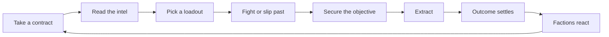

When you raid an ammunition depot, the faction really loses that ammunition. Fewer rounds means its next guards carry less, or are fewer.

Its commander notices within the hour. It may post a **supply order**, and two merchants compete to fill it. It may raise its escorts, or pay someone to raid the rival it blames. So the next contract against it is different, **because of you**.

## 2. Your role

You're an operator: no flag, no faction, paid by the job. Factions and merchants post contracts:
- **Raid** a depot;
- **Sabotage** a production line;
- **Recover** stolen cargo.

You decide which ones to take, how to play them, and what to do with what you bring home.

## 3. Getting started

1. **Open the game.** The first time, a **Welcome** screen explains Training and Live contracts, with a big **Start training** button. You can reopen it any time through *How to play*.
2. **Learn in Training.** Training needs no account, is unscored and never touches the blockchain. Start with **Practice** (section 21).
3. **Sign in when you want live contracts.** Two ways:

   | Sign-in | What happens | Status |
   |---|---|---|
   | **Continue with Google** (also email or passkey), through NEAR Auth | A NEAR account is derived for you behind the scenes. No wallet, no seed phrase | Works up to NEAR's hosted login. NEAR's shared testnet login only accepts `http://localhost:3000`, so a deployed site needs its own client |
   | **I already have a NEAR wallet** | You sign one message to prove the account is yours | Verified on testnet |

   You don't need to understand blockchain to play. Your account holds what you own and identifies you to the server.
4. **Choose a callsign.** After your first sign-in, the **Operator** page asks for one.

## 4. The Hub

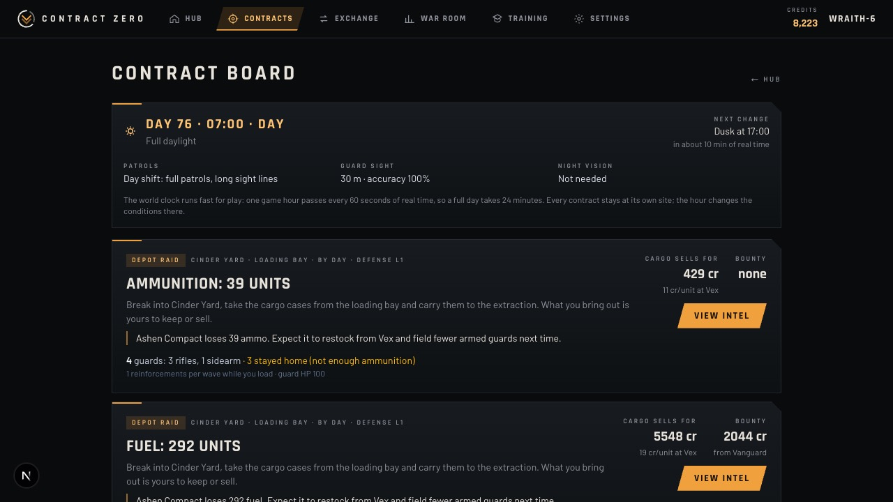

The top bar takes you everywhere:

| Section | What you do there |
|---|---|
| **Hub** | The hangar, your operator, your stash, the world clock and the featured contract |
| **Contracts** | Live contracts posted by the world, with the clock and each site's current conditions |
| **Exchange** | Trade with the merchants, place supply orders, see your owned gear (the **Armory**), and see the official NEAR Intents panel |
| **War Room** | Why the world changed: faction stock, prices, supply orders, decisions and every NEAR transaction |
| **Training** | Campaign, Practice and Endless |
| **Settings** | Graphics, audio, controls and key bindings, interface, accessibility, account and security |
| **Your callsign** (top right) | Operator profile and service record |

## 5. Game modes

| Mode | Where | Scored? | On NEAR? | What it is |
|---|---|---|---|---|
| **Live contracts** | Contracts | Yes | **Yes** (testnet) | Raids, sabotage and recovery at real sites. The outcome changes faction stock and settles on NEAR |
| **Practice** | Training | No | No | Any site, any hour, any operation type, defence L1–L5, any cargo. The same objects and extraction as a live contract |
| **Campaign** | Training | No | No | 15 authored operations across Dustline, Redyard and the Blacksite, ending in boss fights |
| **Kill-House** | Training → Campaign → **M** (operations board) | No | No | Survival: waves of enemies in one arena |
| **Gauntlet** | Same board, unlocked by finishing the campaign | No | No | A harder survival run |
| **Endless: No Exit** | Training | No | No | A procedural chain of rooms that grows as you push. No extraction; it ends when you fall |
| **Seasonal Campaign** | — | — | — | **Not built.** A planned ranked Endless with shared seasonal layouts |

**Live contracts are bound to their site.** A contract is posted against a particular depot at a particular site (Dustline Depot, Blacksite or Cinder Yard). You can't move it elsewhere, and the world clock decides its conditions.

## 6. The three operations

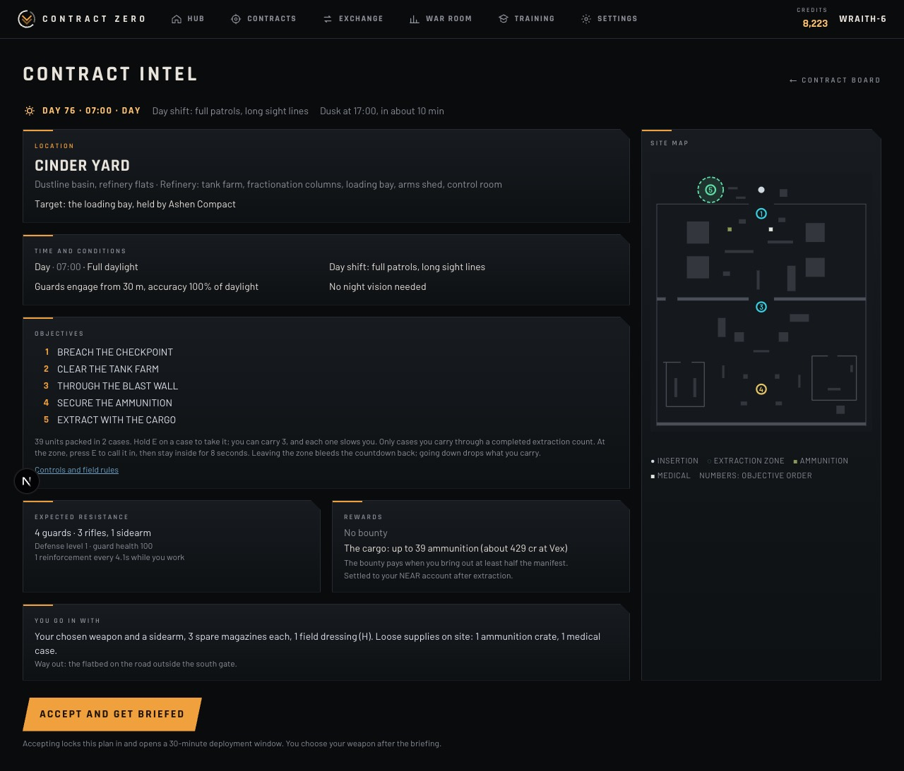

Every live contract opens with **intel**:
- the site and its map;
- the objectives;
- the expected resistance and conditions;
- the reward;
- the extraction point.

You see all of this before you commit.

### Raid: steal the supplies

1. Breach the perimeter.
2. Fight through or avoid the guards.
3. Reach the depot, and **hold E** on cargo cases to take them. Each case is 25 units, and a depot has up to 4.
4. Carry them to the extraction zone. You can carry **3**, and each one slows you about **10%**.
5. Call extraction and hold the zone for **8 seconds**.

You're paid for exactly the cargo you carry out. A raid bounty (paid by whoever sponsored the raid) needs **at least half the manifest**.

> **Tip:** Taking everything isn't always smart. More cases make a slower, harder escape.

### Sabotage: take a production line down

1. Reach the first target and **hold E for 5 seconds** to plant a charge.
2. Do the same at the second target. That lights a **12-second fuse**.
3. Get clear of the **7 m** blast, then extract.

The faction loses **40%** of the targeted stock, and that production line **stops for 36 in-game hours**. You're paid a fee; the destroyed goods are gone for everyone.

> **Tip:** Plant the second charge facing your exit.

### Recovery: bring stolen cargo home

1. Find the seized case and **hold E for 3 seconds** to free it.
2. Carry it to the handover vehicle. It's heavy: about **20%** slower.
3. Signal the handover and hold the zone.

The cargo goes back to its owner, and you're paid a fee.

> **Tip:** Scout the route to the handover before you pick the case up.

## 7. The environments

All three are real, separate maps, and every operation type can happen at each.

| Site | What it is |
|---|---|
| **Dustline Depot** | An outdoor logistics yard: motor pool, container wall, warehouse. Long sight lines and vehicles for cover |
| **Blacksite** | A fortified research facility: floodlit courtyard, labs, control room, vault. Tight rooms and hard corners |
| **Cinder Yard** | The Ashen Compact's refinery: tank farm, fractionation columns, loading bay, arms shed, control room. Machinery noise and steam vents |

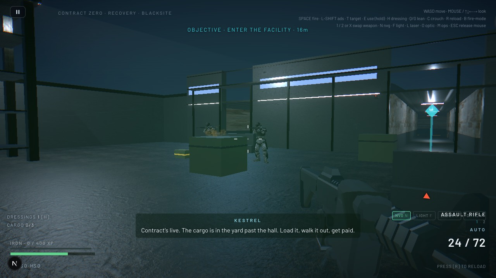
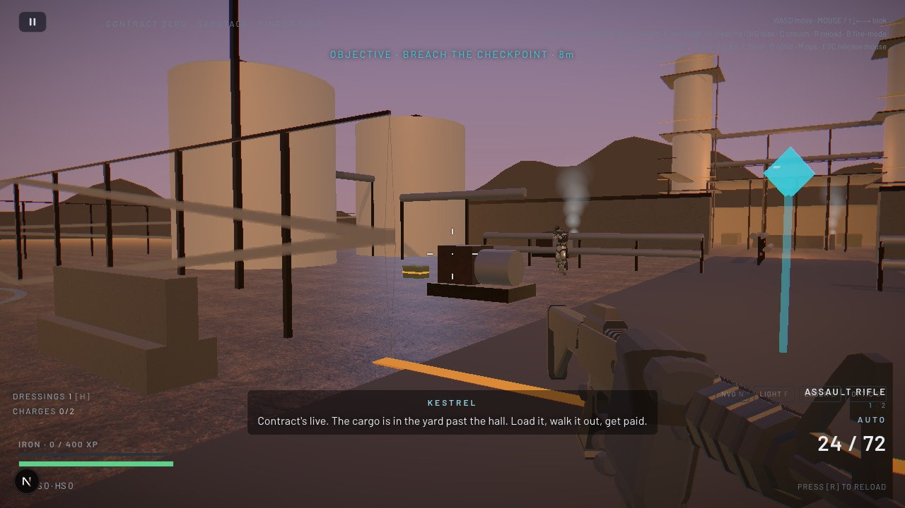

The Training campaign also visits **Redyard**, an authored campaign zone that isn't used for live contracts.

## 8. World time and conditions

The world runs on a clock: **one in-game hour per real minute**, so a full day lasts about 24 minutes. The hour changes conditions at a site, not the site itself. A night raid on Dustline is still a Dustline raid.

| | Day | Dusk | Night |
|---|---|---|---|
| Hours | 06:00–16:59 | 17:00–20:59 | 21:00–05:59 |
| Guard sight | 30 m | 26 m | 20 m |
| Guard accuracy | baseline | 92% | 80% |
| Reinforcements | normal | faster (shift change) | slower |
| Night vision | — | — | issued (**N**) |

The Contracts board shows the clock, the current phase and when it changes next.

## 9. Keyboard and mouse

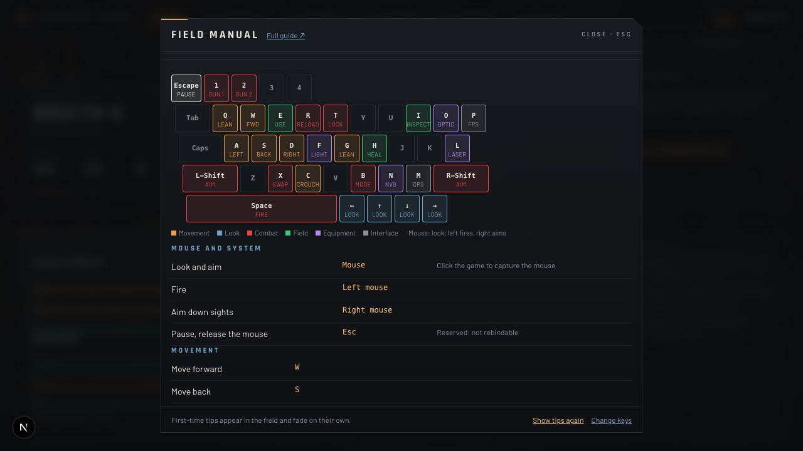

**Click the game to capture the mouse.** These are the default keys. Everything can be rebound in **Settings → Key bindings**, and prompts always show your own keys. The complete, always-current list is **[CONTROLS.md](CONTROLS.md)**, generated from the game's own controls definition.

| Action | Key |
|---|---|
| Move | **W A S D** |
| Look | Mouse (or the arrow keys) |
| Fire | Left mouse or **Space** |
| Aim down sights | Right mouse or **Shift** |
| Reload | **R** |
| Use, interact | **E** (hold) |
| Inspect what you're looking at | **I** |
| Field dressing (heal) | **H** |
| Crouch | **C** |
| Lean left / right | **Q** / **G** |
| Primary / sidearm / swap | **1** / **2** / **X** |
| Fire mode | **B** |
| Target lock (nearest, then cycle) | **T** |
| Night vision / light / laser / optic | **N** / **F** / **L** / **O** (when equipped) |
| Operations board (Training campaign only) | **M** |
| Pause, release the mouse | **Esc** |

**Hold or toggle.** Aim, crouch and use can each be **hold** or **press once** (Settings → Controls), for players who can't hold a key.

**How "use" works:**
1. Walk up to an object and look at it. A prompt appears.
2. Hold **E** until the bar fills.

Looking away, stepping off or letting go stops it. The same applies to ammunition, medical cases, weapons, cargo, charges and extraction.

## 10. Touch

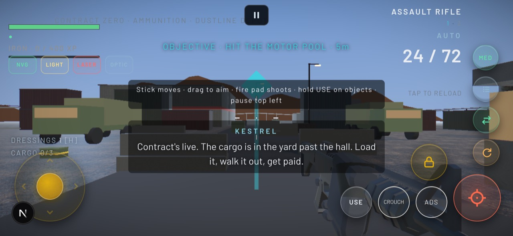

Play in **landscape**. One thumb moves; the other aims and fires.

| Control | Action |
|---|---|
| **Stick** (bottom left) | Move; how far you drag sets the speed |
| **Drag anywhere** | Look. Tap an enemy to lock onto it |
| **Fire pad** (bottom right) | Hold to shoot; slide on it to steer your aim |
| **ADS** | Aim down sights. A **toggle**: tap on, tap off |
| **CROUCH** | A toggle |
| **USE** | Hold until the bar fills |
| **MED** | Field dressing |
| **Lock** (above fire) | Lock the nearest enemy; tap again to cycle |
| **Swap, reload, fire mode** | The column on the right edge |
| **NVG, light, laser, optic** | Chips at the top left (only what your weapon carries) |
| **Pause, EXIT** | Top left |

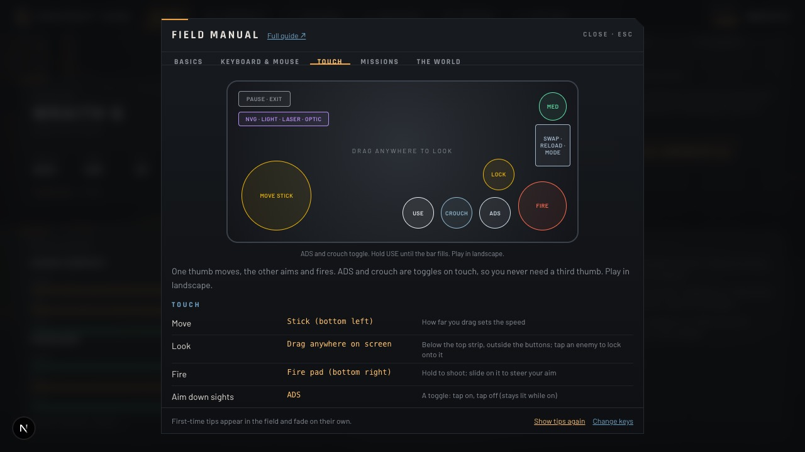

On touch, aim assist gently pulls your aim onto a visible enemy while you fire or aim (Settings → Accessibility can change that).

## 11. Surviving a fight

- **Ammunition is finite.** Your magazine and reserve are what you deployed with. Rifle and pistol rounds aren't interchangeable. Reload with **R**; the ammo counter turns amber when you're low.
- **Use cover.** Crouch behind something solid, and lean (**Q**/**G**) to fire round corners with less of you showing.
- **Heal before it's critical.** A field dressing (**H**) takes a moment and lowers your weapon, so do it in cover. You deploy with a small supply, and medical cases give more.
- **Read the HUD:**
  - **Health:** the bar at the bottom left.
  - **Damage direction:** the red arc.
  - **Threats you can't see:** the edge arrows.
  - **Objective:** the line at the top, with the distance.
- **You get one second wind.** If you go down in a live contract, you drop whatever cargo you were carrying and get back up once. Going down again ends the operation with nothing secured.
- **The objective is the job, not the kill count.** Every extra fight costs ammunition and time.

## 12. Items, weapons and cargo

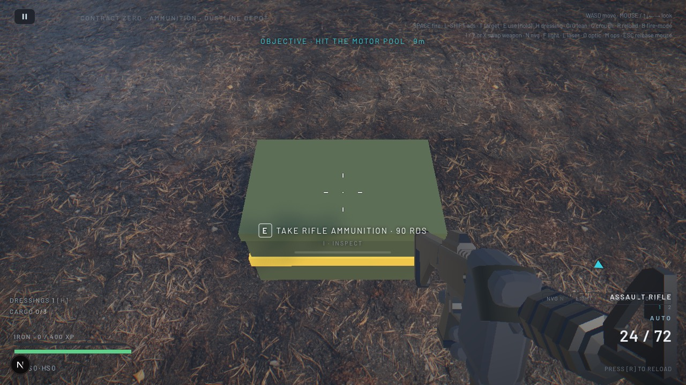

**Two kinds of supplies:**
- **Field supplies** are used up in the fight: ammunition crates, medical cases, and magazines dropped by guards. They refill your reserve or dressings.
- **Cargo** is the economy's goods. Cases you carry out become yours as tokens on NEAR (live contracts only).

Picking up loose rounds doesn't give you ammunition tokens. Extracting a cargo case does.

**Guards' weapons.** A downed guard drops their gun. Hold **E** to:
- **take its rounds**, if you already carry that gun;
- or **swap it in** for the matching slot.

**Inspect** (**I**) anything you're looking at to see what it is, its condition and what it's for.

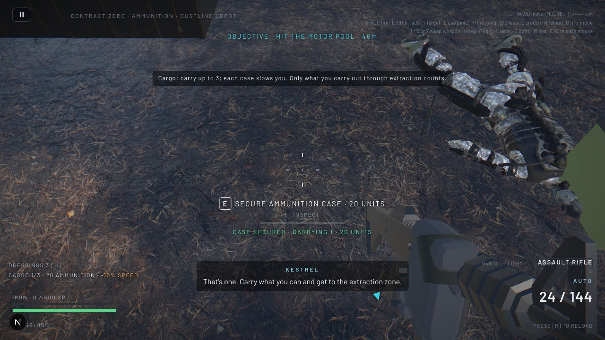

**Carrying cargo:**
- **Limit:** up to 3 cases.
- **Weight:** each slows you about 10% (a recovery case, 20%).
- **Going down** drops everything where you fell.

## 13. Extraction

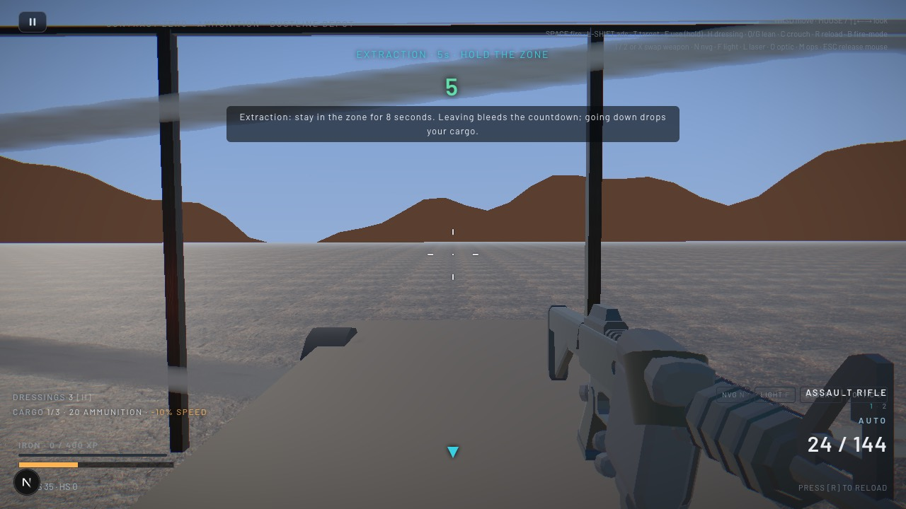

**Finding the zone.** It's marked on the ground with a ring and lights. The objective line points you to it, and an edge arrow shows it when it's off screen.

1. **Unlock it.** Extraction opens once the objectives before it are done (for a raid, once you've secured cargo).
2. **Call it in.** Stand in the zone and hold **E** (or **USE**).
3. **Hold the zone for 8 seconds.** The countdown is large at the top of the screen.
4. **Survive.** Guards keep coming.

**Leaving the zone bleeds the countdown back.** Step out and it drains at half speed, so get back in quickly. Going down cancels the extraction.

**Reaching the zone isn't escaping.** Only a completed countdown counts.

## 14. Success, failure and partial payouts

**On a successful live contract**, the results screen shows:
- what you secured, with any bounty or fee;
- what the operation did to the faction's stock (before → after);
- the debrief.

**Settlement on NEAR happens after the mission:**

| You see | It means |
|---|---|
| **Settling on NEAR…** | Your result is recorded and the transaction is queued or in flight |
| **Settled on NEAR testnet: `<transaction>`** | Confirmed on chain. Click it to see the transaction |

Only *Settled on NEAR* means the transfer happened on chain. Settlement normally takes seconds, but can take longer if the network or the queue is slow.

**Partial raids** pay for the cases you carried out. **Failures** (killed, or a run the server rejects) pay nothing. **Practice and Training** never pay or settle.

The server checks every live run: your movement, timing and what you actually picked up. A run faster than the mission physically allows, or one with impossible movement, is rejected.

## 15. Credits, resources and equipment

| Asset | What it does in the world |
|---|---|
| **Credits** | The currency: trades, wages, bounties, contracts |
| **Ammunition** | How many guards a faction can arm, and with what |
| **Medicine** | Reinforcements during a fight |
| **Fuel** | Whether a faction can stage a depot or run supply convoys |
| **Guns you own** | Better weapons for your loadout |

All of these are **NEP-245 tokens on NEAR testnet**, held in your own account. **Credits are game currency**, not NEAR and not a cryptocurrency with an exchange rate.

**Sources and sinks.** Factories produce and convoys deliver; garrisons consume, escorts cost wages and sabotage destroys stock. Every unit is accounted for.

## 16. The Exchange

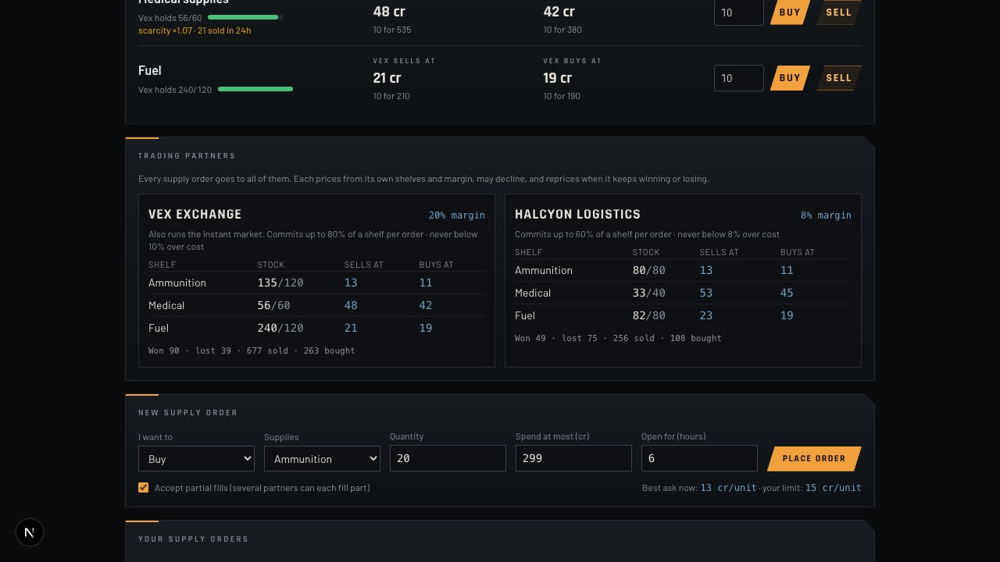

**Trade instantly with Vex.** Pick a resource and quantity, then **Buy** or **Sell**. Vex gives a **firm quote for 5 minutes**, holding its side so nobody can take it. You accept by signing in your wallet (or automatically with **quick trade**, below). Prices move with Vex's stock and demand, and Vex may decline to buy when it's short of credits.

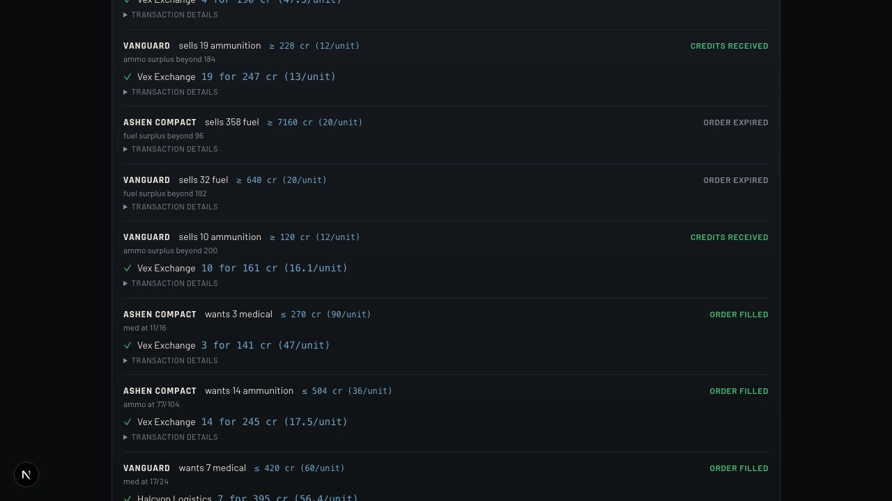

**Place a supply order.** This is often cheaper than Vex's instant price:
1. Choose **Buy** or **Sell**, the supplies, the quantity, the most you'll spend (or least you'll take), whether partial fills are fine, and how long it stays open.
2. **Place order.** Your credits (or goods) are held by the contract until the order fills, expires or you cancel.
3. **Vex Exchange** and **Halcyon Logistics** each decide whether to offer, and at what price. The cheapest offer is marked **Best Offer**.
4. **Accept** the one you want. The contract won't let any fill exceed your limit, and you get back whatever you didn't use.

You can **cancel** an open order at any time. The statuses read *Order Filled*, *Credits Received*, *Order Expired* and *Partly filled*. **Transaction details** (collapsed) shows every step on chain.

**Quick trade** opens a limited key in your browser, so trades and orders go through without a wallet prompt each time.
- **Limits:** a credit budget, a sale budget and an expiry that you choose. The game contract enforces them.
- **Revoke:** you can revoke it at any time (Settings → Account & security), and the game confirms on chain that it's revoked.
- **Scope:** it can never move your assets anywhere but into trades you started.

**Your owned gear** is listed under **Armory · owned gear**. Guns you buy there are tokens in your account, and you can take them into any contract from the loadout.

**NEAR Intents (the official protocol).** A separate panel shows the real NEAR Intents network on mainnet: live quotes for real tokens, with the minimum you'd receive and the fees. It's labelled *dry quotes only, not executed*: it doesn't trade game items, and game credits aren't for sale. See [INTENTS.md](contract-zero/INTENTS.md).

## 17. The living world

| Who | What they want |
|---|---|
| **Vanguard** | A military faction that makes its own ammunition and needs medicine and fuel. Raises escorts after raids |
| **Ashen Compact** | A fuel-refining militia (Cinder Yard is theirs). Short of ammunition, aggressive: it pays to have Vanguard raided first |
| **Vex Exchange** | The big merchant: deep shelves, instant trades, sponsors raids on what it's short of |
| **Halcyon Logistics** | A lean supplier: thinner margins, smaller shelves, competes with Vex for every supply order |

Every in-game hour, each faction's commander checks:
- its stock against what it needs;
- what's already on the road;
- prices;
- its treasury.

Then it decides:
- **buy** through a supply order;
- **wait** for prices to fall;
- **sell** surplus;
- **change its guard**;
- **post a bounty** on a rival.

Merchants price from their own shelves, and adjust their margins when they keep winning or losing.

**Are these real AI agents?** The world runs on **deterministic rules**, with every decision logged and checked. Optionally, a NEAR AI language model proposes strategy. Its proposals are checked against the same rules before anything happens, and it never controls a gunfight, a balance or a key. Without it (as now, while the project's NEAR AI account has no credits), the deterministic rules run everything.

## 18. The War Room

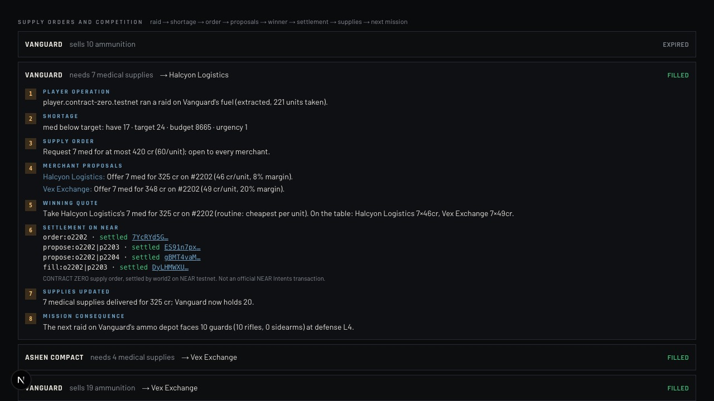

After an operation, open the **War Room** and follow what you started. It shows:
- **Region and prices:** every faction's and merchant's stock, and how prices moved.
- **Supply orders and competition:** for each order, the full chain:
  1. your raid;
  2. the shortage;
  3. the order;
  4. each merchant's offer, or its reason for declining;
  5. the winner and why;
  6. each settlement step on NEAR, with links;
  7. what was delivered;
  8. what the next mission against that faction now faces.
- **Why the world changed:** every decision (trigger → what it saw → what it proposed → validation → transaction → consequence), filterable by *operations*, *NEAR AI* and more.
- **Observer Mode:** runs the economy forward on a copy of the world. It's clearly labelled *simulation*: nothing in it happened.

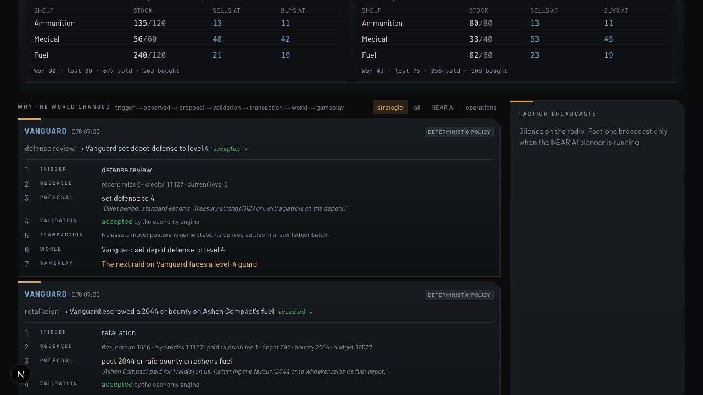

## 19. Ownership and progression

- **Ownership.** What you extract (resources) and buy (guns) is yours, as tokens in your NEAR account. The game moves them only with your signature, or inside a quick-trade budget you set.
- **Rank and XP.** These grow with every kill and operation; the HUD shows your rank bar.
- **Standing.** Factions remember who hit them, and Vex rewards regular customers with better prices.
- **Your record.** Your service record (Operator page) lists your operations and their settlement.

## 20. Mistakes, troubleshooting and FAQ

**Common mistakes:**
- Grabbing every case, then getting caught slow in the open. Carry what you can protect.
- Stepping out of the extraction zone to shoot. It bleeds the countdown.
- Healing in the open.
- Running dry mid-fight. Check your reserve before you push.

**FAQ:**

- **Do I need crypto to play?** No. Training and Practice need nothing. Live contracts need an account (Google or a NEAR wallet); the game pays the gas for account setup.
- **Can I choose the map?** In Practice, yes. A live contract's site is set by the contract.
- **Why is a contract missing?** Its faction may not have the stock, or the fuel to stage a depot, or the line may be down after sabotage. The board changes every in-game hour.
- **Why didn't I get the whole manifest?** You're paid for the cases you carried out. A bounty needs at least half.
- **I finished but no tokens yet?** Look for *Settling on NEAR…*. It becomes *Settled* once confirmed.
- **Can I keep a guard's gun?** Yes: swap it into your loadout for that operation. Owning a gun permanently means buying it in the Armory.
- **Is Endless connected to the economy?** No. It's an unscored challenge.
- **Is NEAR Intents integrated?** The official protocol is connected **read-only**: live quotes for real tokens, nothing executed, and game items aren't tradable on it. The game's own **supply orders** are a separate intent-style market for game supplies, settled by the game's contracts on testnet.
- **The mouse isn't aiming.** Click the game to capture the mouse; Esc releases it. The arrow keys also aim.
- **On a phone it says to rotate.** The game is landscape only.
- **It's slow.** Settings → Display: try **Auto** or **Low**, or lower the resolution scale or cap the frame rate.

## 21. Your first operation: a Practice raid

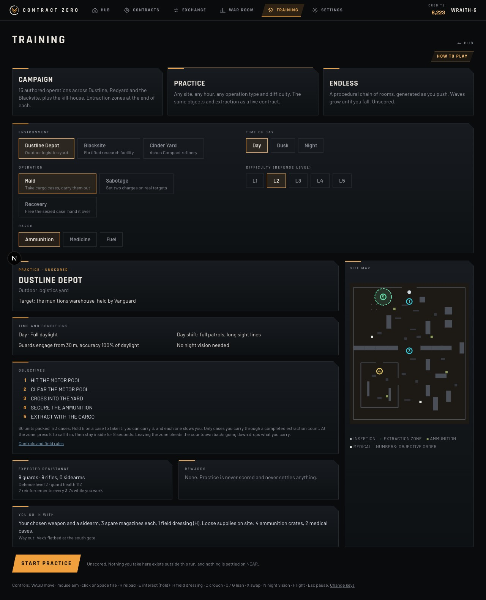

1. **Training → Practice.** Choose **Dustline Depot, Day, Raid, L1, Ammunition**, and read the intel.
2. **Start practice.** A tip shows the controls once. You can turn tips off or replay them in Settings.
3. **Push in.** Click to capture the mouse, then use **WASD** and the mouse. Follow the objective line at the top.
4. **Grab supplies.** Look at an ammunition crate and **hold E** until the bar fills.
5. **Take a cargo case** (**hold E**). Notice that you're slower now.
6. **Head for extraction.** Follow the objective arrow to the zone.
7. **Call it in.** Hold **E**, then stay inside for 8 seconds.
8. **Done.** The result shows what you'd have secured. Nothing was scored and nothing settled.

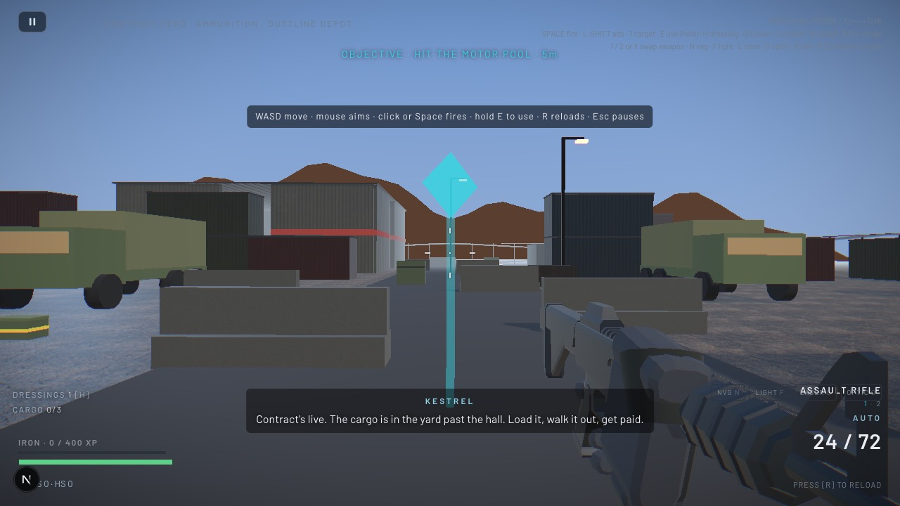

When you can do that reliably, try a **night raid at Blacksite** (night vision on **N**), then a **sabotage**.

## 22. What next

1. **Take a live contract.** Sign in, then go to **Contracts → View intel → Accept and get briefed → Choose loadout → Deploy**.
2. **Extract, then watch the results** settle on NEAR.
3. **Open the War Room** and follow your raid into the faction's response.
4. **Trade your haul** at the Exchange: sell it to Vex, or post a supply order and let the merchants compete.
5. **Take another contract against the same faction.** It won't be the same fight.

**What you take changes what happens next.**
